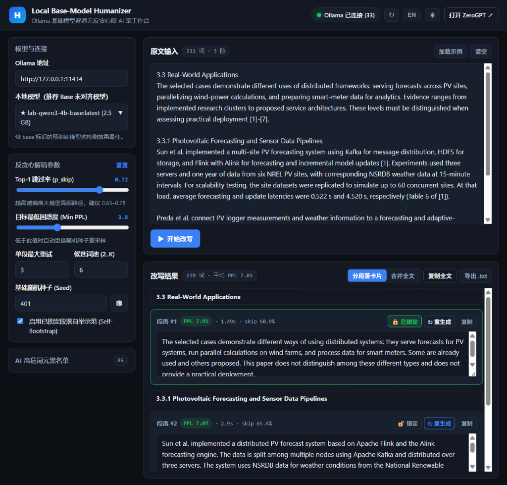

# Local Base-Model Humanizer Studio

A zero-dependency local GUI and CLI tool that rewrites English academic and technical prose using an **unaligned local Ollama base model** (`lab-qwen3-4b-base:latest` or any local base model) with **token-level `logprobs` anti-greedy decoding**, a **hard AI-buzzword logit blacklist**, **alternating style demonstrations**, and **per-paragraph self-bootstrapping**.

一款零第三方依赖的本地可视化工作台（GUI）与命令行工具，通过调用本地 Ollama **未经 RLHF 对齐的基础预训练模型**，在逐词元（token-by-token）`logprobs` 解码层执行**反贪心采样 + AI 高危词元黑名单掩码 + 困惑度自动重采样 + 单段锁定自举**，将英文学术/技术文本改写为更贴近人类分布的自然表达。



---

## Key Features / 核心特性

- **Zero External Dependencies / 零依赖即开即用**：纯 Python 3.10+ 标准库驱动本地 Web GUI（`ThreadingHTTPServer` + SSE 实时流式推送），无需 `pip install`。
- **Unaligned Base-Model Token Steering / 基础模型词元级控制**：通过 Ollama `raw: true` 与 `logprobs: true` 接管每一步解码，在内容词首以可调概率 `p_skip` 跳过模型最容易选的 Top-1 AI 词，从 Rank `2..K` 候选词池中重采样。
- **Hard AI-Buzzword Logit Blacklist / AI 高危词根硬屏蔽**：内置 70+ 高频 AI 词根黑名单（如 `utiliz`, `employ`, `leverag`, `demonstrat`, `illustrat`, `furthermore`, `moreover`, `allowing`, `ensuring` 等），可在界面中实时编辑与恢复默认。
- **Auto-PPL Verification & Retry / 困惑度自动校验重采样**：每段自动计算真实困惑度（PPL），低于目标阈值（默认 `3.8`）时自动更换随机种子重采样。
- **Paragraph-Level Lock & Self-Bootstrap / 分段锁定与一键单段重生成**：
  - 支持对已通过检测的段落点击 **🔒 锁定**，再次运行或重生成其他段落时自动跳过已锁定段落；
  - 开启 **Self-Bootstrap** 后，可将已锁定的高质量段落自动作为上下文风格示范，用来引导其余未通过段落的重生成。
- **Structure Preservation / 自动保留结构**：自动识别并原样保留章节标题（`3.3.1 ...`、`# ...`）以及行首引导小标题（如 `RQ1. Framework roles.`、`Edge and federated forecasting.`）。
- **Bilingual Dark/Light Studio UI / 双语暗亮双色界面**：支持中英文界面一键切换、暗色/亮色主题切换、自动发现本地 Ollama 模型并星标推荐 Base 模型、一键复制全文与导出 `.txt`。

---

## Prerequisites / 环境准备

1. **Python 3.10+**
2. **Ollama**（v0.4+，支持 `/api/generate` 返回 `logprobs`）运行在本地 `http://127.0.0.1:11434`
3. 至少拉取或导入一个本地 **Base** 基础模型（推荐 `lab-qwen3-4b-base:latest` 或其他 Qwen/Llama Base GGUF 模型）。

---

## Quick Start / 快速上手

### 1. Launch GUI / 启动可视化界面

Windows 用户可直接双击 [`launch.bat`](launch.bat)，或在终端运行：

```bash
python app.py
```

默认会在浏览器自动打开 `http://127.0.0.1:8765`。

可选参数：

```bash
python app.py --host 127.0.0.1 --port 8765 --no-browser
```

### 2. CLI Mode / 命令行模式

```bash
python core.py --input input.txt --output output.txt --model lab-qwen3-4b-base:latest --p-skip 0.72 --min-ppl 3.8 --attempts 3
```

---

## Project Structure / 项目结构

```text
local-base-humanizer/
├── app.py          # Local HTTP/SSE server & API endpoints
├── core.py         # Anti-greedy decoding engine, blacklist mask, CLI entrypoint
├── launch.bat      # Windows one-click launcher
├── static/
│   ├── index.html  # Studio GUI markup
│   ├── styles.css  # Dark/Light editorial UI theme
│   └── app.js      # SSE streaming, paragraph lock/regen, Ollama discovery, i18n
├── LICENSE
└── README.md
```

---

## Recommended Workflow / 推荐工作流

1. 确认右上角状态灯为 **Ollama 已连接**，并选择带 `★` 标识的本地 Base 模型。
2. 粘贴英文文本，点击 **开始改写**（默认 `p_skip = 0.72`, `Min PPL = 3.8`）。
3. 将结果复制到检测工具检查；把已通过的段落点击 **🔒 锁定**。
4. 勾选 **Self-Bootstrap**，对仍需优化的单个段落点击 **↻ 重生成**，即可快速收敛。

---

## License

MIT License
